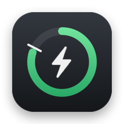
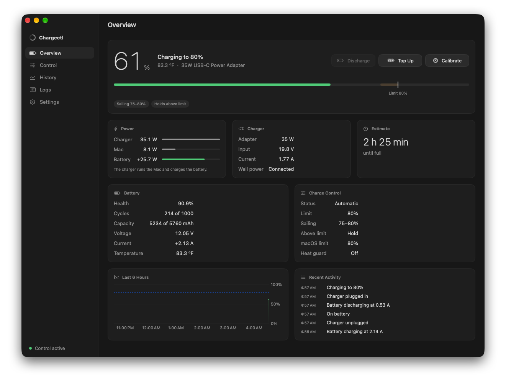
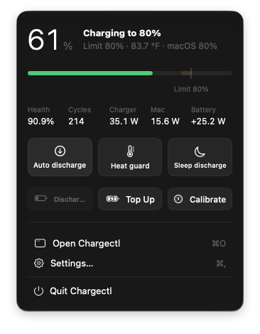
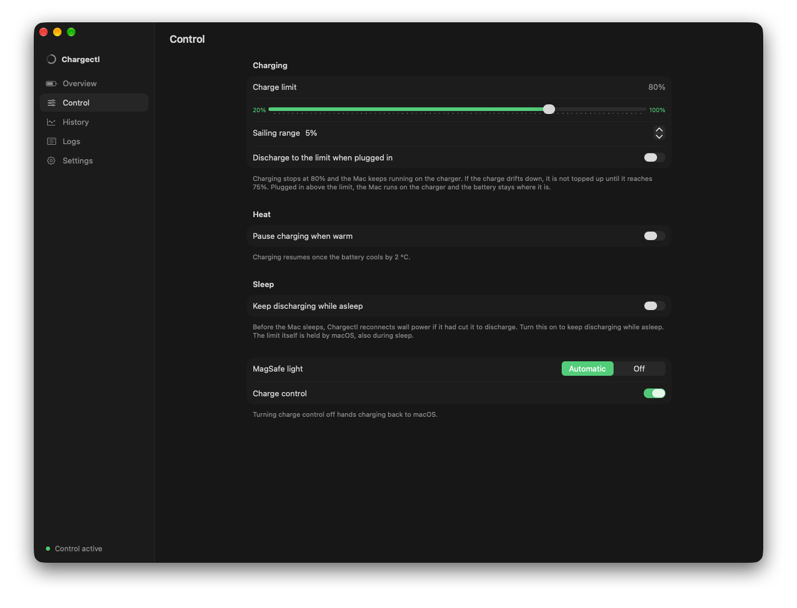
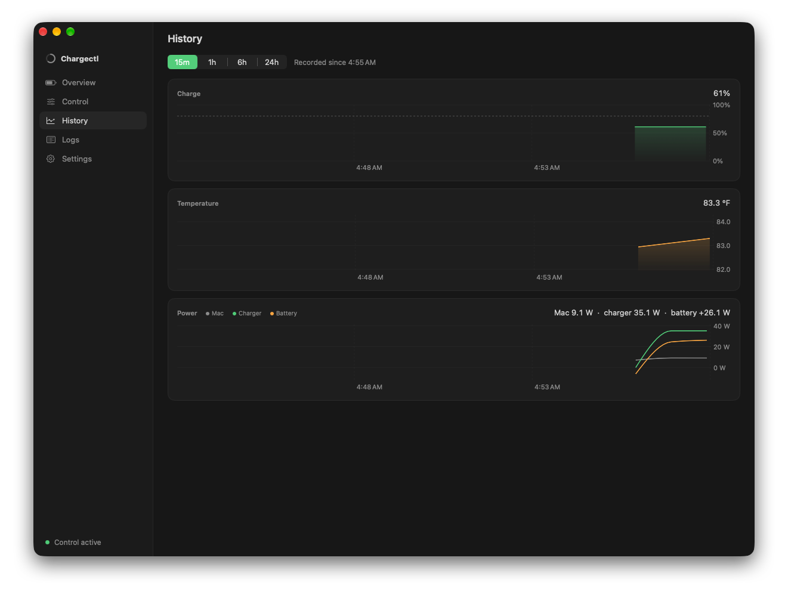
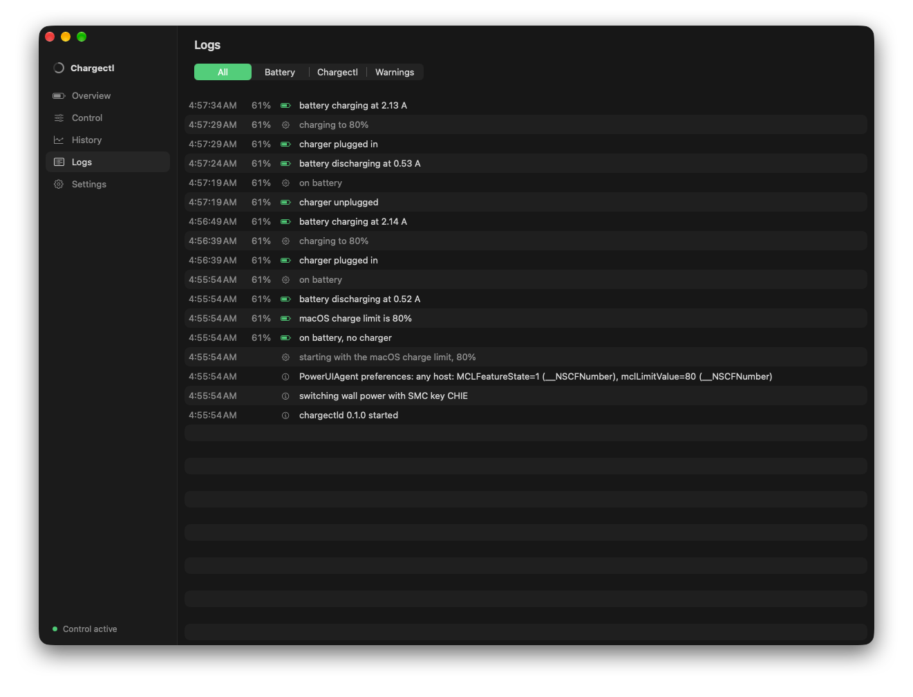
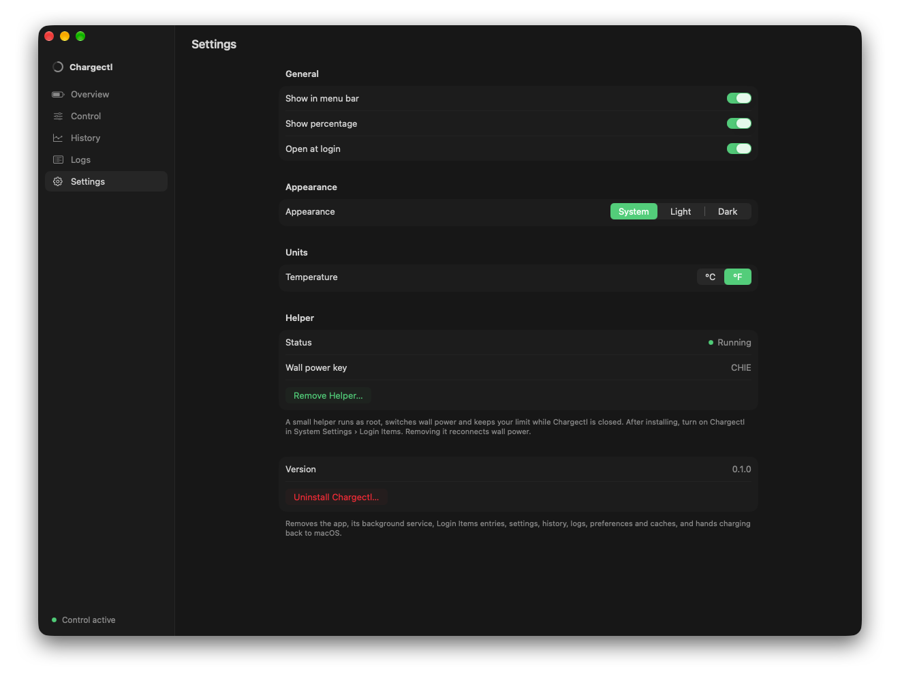
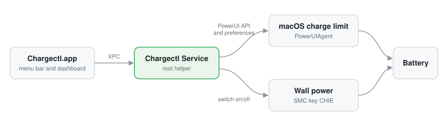

<p align="center">
  
</p>

<h1 align="center">Chargectl</h1>

<p align="center">
  <strong>Battery charge limits for Apple silicon MacBooks, from the menu bar.</strong>
</p>

<p align="center">
  <a href="https://github.com/tyldra-org/chargectl/actions/workflows/ci.yml"></a>
  <a href="LICENSE"></a>
  
  
  
</p>

<p align="center">
  <a href="#quickstart">Quickstart</a> ·
  <a href="#features">Features</a> ·
  <a href="#screenshots">Screenshots</a> ·
  <a href="#how-it-works">How it works</a> ·
  <a href="#install-and-uninstall">Install</a> ·
  <a href="CONTRIBUTING.md">Contributing</a> ·
  <a href="SECURITY.md">Security</a>
</p>

<p align="center">
  
</p>

---

Lithium-ion batteries wear faster when they sit at 100%. Chargectl stops charging
at the limit you choose, anywhere from 20% to 100%, and keeps your Mac running on
the charger while the battery rests. It works with macOS's own charge limit
instead of around it, shows what the charger, the Mac and the battery are doing
each second, and keeps working while the app is closed.

## Quickstart

| Requirement | Version |
| --- | --- |
| Mac | Apple silicon MacBook |
| macOS | 27 or later |

```sh
brew install --cask tyldra-org/tools/chargectl
```

You can also download `Chargectl-<version>.zip` from
[Releases](https://github.com/tyldra-org/chargectl/releases/latest), or
[build it from source](#build-from-source).

Then open **Chargectl** from Applications. A short welcome walks you through:

1. **Installing the helper**, the small root service that controls charging.
   macOS asks for your password once. Updates restart the helper and reopen
   Chargectl by themselves.
2. **Choosing a limit.** It starts from the limit already set in System Settings ›
   Battery, so nothing changes until you pick another one.

After that Chargectl lives in the menu bar. Click  to see your battery,
switch options and drag the white marker to change the limit.

> [!IMPORTANT]
> Quit any other charge limiter, such as AlDente, before you install. Two of
> them fight over the same settings.

## Features

| | |
| --- | --- |
| **Charge limit, 20% to 100%** | Charging stops at the limit and the Mac runs on the charger. The battery is not used to hold it. |
| **Sailing** | After reaching the limit, the charge may drift down a few percent before charging resumes, so the battery is not topped up all day. |
| **Above the limit** | Plugged in above the limit, either hold the current charge or discharge down to the limit. |
| **Overcharge guard** | When macOS charges past the limit anyway (its occasional charge to 100%, or "Charge to Full Now"), Chargectl brings the battery back. |
| **Two-way sync** | Chargectl's limit shows in System Settings › Battery, and a limit chosen there becomes Chargectl's limit. |
| **Jobs** | Top up to 100% once, discharge to the limit, or calibrate the battery gauge. |
| **Heat protection** | Pause charging while the battery is warm. |
| **Live readings** | Charger, Mac and battery power each second, battery health, cycles and temperature. |
| **Time to the limit** | How long until the charge reaches your limit, the end of sailing or a discharge target, or empty on battery. |
| **Energy by app** | The apps using significant energy, averaged over the last minute, with each app's helpers and commands counted for it. |
| **History and logs** | 24 hours of charge, temperature and power, and a log of what the battery and Chargectl did. |
| **Automatic updates** | New releases install themselves while Chargectl's windows are closed, checked against their checksum and code signature. On by default; Settings › Updates. |
| **Clean removal** | Uninstall restores normal charging and your macOS limit, and removes every file Chargectl added. |

## Screenshots

<table>
  <tr>
    <td align="center" valign="top">
      <br>
      <b>Menu bar</b><br>
      <sub>Charge, live power and quick switches. Drag the white marker to change the limit.</sub>
    </td>
    <td align="center" valign="top">
      <br>
      <b>Control</b><br>
      <sub>Limit, sailing range, what happens above the limit, heat and sleep.</sub>
    </td>
  </tr>
</table>

<table>
  <tr>
    <td align="center" valign="top">
      <br>
      <b>History</b><br>
      <sub>Charge, temperature and power for up to 24 hours.</sub>
    </td>
    <td align="center" valign="top">
      <br>
      <b>Logs</b><br>
      <sub>Every battery change and every Chargectl action, filterable.</sub>
    </td>
    <td align="center" valign="top">
      <br>
      <b>Settings</b><br>
      <sub>Menu bar, appearance, units, the helper and uninstall.</sub>
    </td>
  </tr>
</table>

## How it works

On current Apple silicon firmware, the SMC keys that pause charging (`CH0B`,
`CH0C`, `CHTE`, `bfF0`) are reserved for Apple through a private entitlement, so
no third-party process can pause charging directly. Chargectl uses the two tools
that remain:

<p align="center">
  <picture>
    <source media="(prefers-color-scheme: dark)" srcset="docs/assets/architecture-dark.svg">
    
  </picture>
</p>

- **macOS's own charge limit.** PowerUIAgent holds the entitlement. At its limit
  the battery holds its charge while the Mac runs on the charger; above it the
  battery discharges to the limit. Limits from 80% to 100% go through
  `PowerUISmartChargeClient`. Lower limits are written to PowerUIAgent's
  preferences (`com.apple.smartcharging.topoffprotection`, `mclLimitValue`)
  after an allowed 80% request, and the `com.apple.smartcharging.defaultschanged`
  notification makes PowerUIAgent reload them. Chargectl reads the limit back and
  falls back to switching wall power if macOS did not take it.
- **Switching wall power** with the `CHIE` SMC key, which runs the Mac on its
  battery while the charger stays plugged in. It is used to discharge to a limit
  below 80%, for heat protection, calibration, the overcharge guard and the
  fallback.

| Situation | What Chargectl does |
| --- | --- |
| Charging to the limit, or at it | Sets macOS's limit to the limit. The Mac holds on the charger. |
| Above the limit, holding | Sets macOS's limit to the current charge. |
| Above the limit, discharging, 80% or more | Sets macOS's limit to the limit; macOS discharges to it. |
| Above the limit, discharging, below 80% | Cuts wall power until the limit, sets macOS's limit, then reconnects. |
| Sailing | macOS's limit follows the charge down until limit minus sailing, then charging resumes. |
| Heat protection | Cuts wall power at the threshold and reconnects 2 °C below it. |
| Sleep | macOS holds the limit while asleep. A discharge in progress reconnects wall power before sleep unless "Sleep discharge" is on. |

Chargectl saves your own macOS charge limit before its first change and restores
it when it stops, when you turn charge control off and when you uninstall.
Readings come from the `AppleSmartBattery` registry entry and live SMC keys
(`B0AC`, `B0AV`, `PDTR`, `PSTR`, `VD0R`, `ID0R`, `TB0T`) and need no privileges.

## Install and uninstall

### Homebrew

```sh
brew install --cask tyldra-org/tools/chargectl                  # install
brew update && brew upgrade --cask tyldra-org/tools/chargectl   # update
brew uninstall --zap --cask tyldra-org/tools/chargectl          # remove everything
```

Chargectl updates itself, so `brew upgrade` without a name skips it. Use the
full name `tyldra-org/tools/chargectl`: Homebrew only loads casks from
other taps when you name them, or after `brew trust tyldra-org/tools`.

### Download

Each [release](https://github.com/tyldra-org/chargectl/releases) has
`Chargectl-<version>.zip`, its SHA-256 checksum and a build provenance
attestation. Unzip it and move Chargectl to Applications. Releases are not
notarized, so macOS blocks the first launch of a downloaded copy: open it once,
then choose **Open Anyway** in System Settings › Privacy & Security. To check a
download:

```sh
shasum -a 256 -c Chargectl-<version>.zip.sha256
gh attestation verify Chargectl-<version>.zip --repo tyldra-org/chargectl
```

### Build from source

Needs Xcode 27 and [XcodeGen](https://github.com/yonaskolb/XcodeGen)
(`brew install xcodegen`).

```sh
git clone https://github.com/tyldra-org/chargectl.git
cd chargectl
./scripts/install.sh           # build and install the app
./scripts/install.sh --logs    # same, then follow the helper's log
./scripts/uninstall.sh         # remove everything Chargectl added
```

Run `install.sh` again after pulling changes. The helper notices the new app and
restarts into it. If `Chargectl.app` is deleted, the helper removes itself.

### Uninstall

**Settings › Uninstall Chargectl** works for every install method and does the
same as `uninstall.sh`. It reconnects wall power, restores your macOS charge
limit, and removes:

- the helper, its launchd job, its sudoers rule, data, caches and crash reports;
- the Login Items entries, preferences, caches and saved state;
- Chargectl's tile in the Dock, pinned or under recent apps;
- Homebrew's record of the cask, its cached download, and the
  `tyldra-org/tools` tap when nothing else from it is installed.

If the helper is not running, it asks for your password and does the same as an
administrator.

### Signing

`install.sh` signs with a Developer ID or Apple Development certificate when one
is in your keychain (see [`scripts/signing.sh`](scripts/signing.sh)); otherwise
the build is signed ad hoc, as releases are.

- **Ad hoc:** Install Helper writes a launchd job to `/Library/LaunchDaemons`
  with your administrator password. macOS ties a background item's approval to
  an ad-hoc build, so the Login Items route would stop the helper after every
  update; a launchd job keeps working. Login Items lists it as "Chargectl
  Service".
- **With a team:** Install Helper registers the helper with SMAppService. It is
  listed under Chargectl in Login Items, you turn it on once, and the approval
  carries over to updates. The helper only accepts the Chargectl app signed by
  the same team.

## Limitations

- Chargectl relies on private macOS interfaces: PowerUI, PowerUIAgent's
  preferences and SMC keys. A macOS or firmware update can change them.
- The helper runs as root. [SECURITY.md](SECURITY.md) describes what it can do and
  who can talk to it.
- Releases are signed ad hoc and not notarized. The Homebrew cask removes the
  quarantine flag after install so the app opens; a downloaded zip needs
  **Open Anyway** once.
- Only Apple silicon MacBooks on macOS 27 are supported and tested.

## Development

| Path | Contents |
| --- | --- |
| [`App/`](App) | Menu bar app: welcome, dashboard, menu bar panel, XPC client |
| [`Daemon/`](Daemon) | Chargectl Service: control loop, SMC and macOS limit adapters, XPC service |
| [`Shared/`](Shared) | Code built into both: SMC access, battery readings, `ChargePolicy`, XPC models |
| [`Tests/`](Tests) | Swift Testing suites for the charging policy and shared models |
| [`scripts/`](scripts) | Build, test, install, uninstall and the CI entry point |

```sh
./scripts/check.sh   # format, build, test, shell and workflow checks (what CI runs)
./scripts/test.sh    # unit tests only
./scripts/run.sh     # install a Debug build
```

### Releasing

1. Set `MARKETING_VERSION` in [`project.yml`](project.yml) and move the
   `Unreleased` entries in [`CHANGELOG.md`](CHANGELOG.md) under the new version.
2. Merge that to `main`, then tag it:

   ```sh
   git tag -a v0.2.0 -m "Chargectl 0.2.0" && git push origin v0.2.0
   ```

The [release workflow](.github/workflows/release.yml) checks that the tag
matches `project.yml`, runs the tests, builds and attests
`Chargectl-<version>.zip`, publishes the release with notes from the changelog,
and opens a pull request that updates the cask in
[tyldra-org/homebrew-tools](https://github.com/tyldra-org/homebrew-tools).
`./scripts/package.sh` builds the same zip locally.

Charging decisions live in [`ChargePolicy`](Shared/Control/ChargePolicy.swift),
a pure function tested without hardware. Read [CONTRIBUTING.md](CONTRIBUTING.md)
before opening a pull request, and [AGENTS.md](AGENTS.md) if you work with a
coding agent.

## Contributing

Contributions are welcome. Read [CONTRIBUTING.md](CONTRIBUTING.md) and follow the
[Code of Conduct](CODE_OF_CONDUCT.md). Changes to how charging is controlled must
be tried on a real MacBook; say which one in the pull request.

## Security

Report vulnerabilities privately as described in [SECURITY.md](SECURITY.md). Do
not open public issues for security problems.

## License

Chargectl is licensed under the [Apache License 2.0](LICENSE).
Copyright 2026 Yogesh Prasad.
